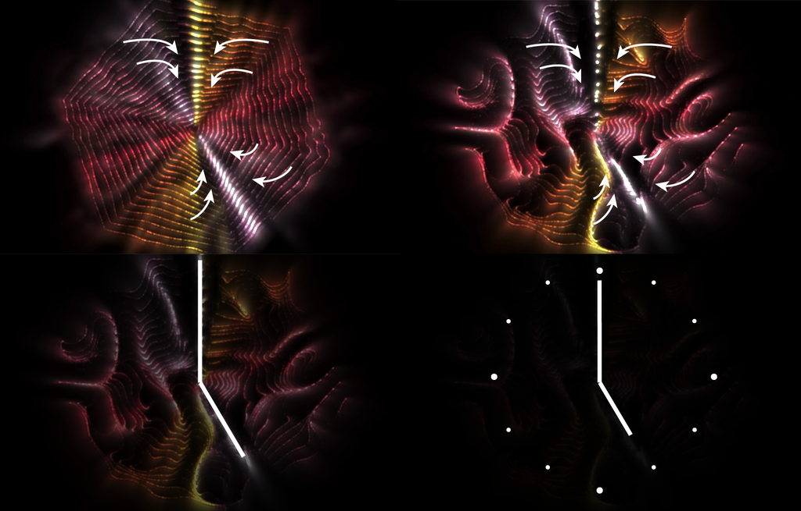
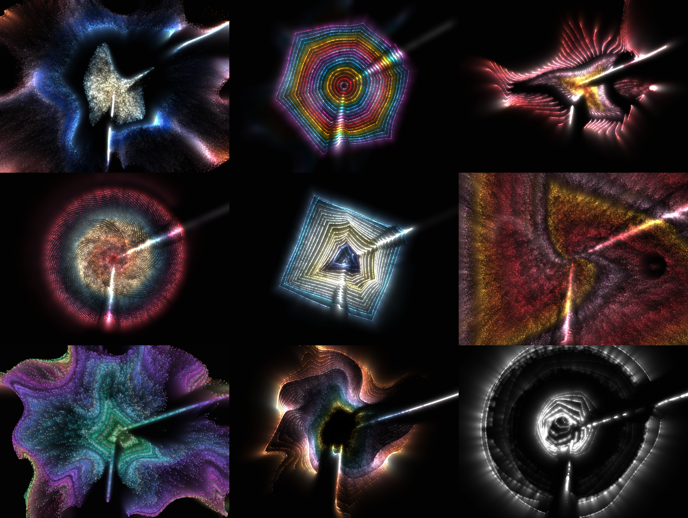

+++
title = "720 Minutes"
weight = 1

[extra]
medium = "Digital"
tags = ["time"]
year = 2021
+++

720 Minutes is a collection of 720 unique generative live, interactive, animated clocks that live infinitely on the blockchain, all derived from the same algorithm. Each iteration of the algorithm is attributed a unique set of visual features, making sure each piece is different. The result is a generative piece that can be accessed by anybody at anytime given access to the Internet.

720 Minutes is a reflexion on time and while every twelve hours (12*60 = 720 minutes) the hands of any analog clock are the same, we are different. To further emphasize this progression, each iteration of 720 Minutes has its own special time, a ‘magic minute’ of sorts, where every twelve hours the clock will activate in a fireworks of effects. (Each iteration is assigned a fixed minute over the 720 possible minutes.) While each 720 Minutes will keep its appearance forever, we, on the contrary, will age at the slow pace of time.





<figure>
  
</figure>

## Clock
The clock is ticking every second and the particles form the hands for the hours and the minutes. Some might be harder to see, so here is a simple diagram:

## Generative Art
The whole piece of 720 Minutes is a single javascript script that weights 17kb and that is stored on the Ethereum blockchain as a text file. Each iteration of 720 Minutes is generated from the same script, where a unique <b>hash</b>, created when the piece was minted (purchased) is used to derive all properties of the piece.

The algorithm at its core can be expressed as a particle simulation: a lot of colored circles are generated each second and are flowing along some noise field. How the colors are assigned to the particles, where those particles start and how they move is where the algorithm shows its strength.

720 Minutes explored the generative space of that algorithm using a set of 17 features, giving each iteration its unique appearance, from the color palette, the shapes used to the intensity of the flow of particles. Here are a few examples of what the algorithm has produced in terms of variation.

## Magic Minute

720 Minutes plays with the idea of twelve hours cycles: every twelve hours the hands of the clock are in the same position, yet we are not. We have aged, and the world has moved on. The display of the clock has not. The persistence of the piece is guaranteed by the blockchain: I would argue that if the Ethereum blockchain disappears, we are looking at a civilization ending event. Each 720 Minutes will show the time in their unique way forever.

But each 720 Minutes is linked to _one_ minute across the whole twelve hours period. 720 Minute #0 corresponds to 10:36. 720 Minute #1 is 8:48. 12:00 is 720 Minutes #672. (A complete list can be found [here](https://docs.google.com/spreadsheets/d/1Gde_FENLYWUX9xS-1ni8Gb2QGw30mpuAb7AkkUXdRIM/edit#gid=0).) When time comes, each 720 Minutes will activate and show some special effects to celebrate the occasion. One minute to reflect on what happened during the past twelve hours. A reminder that time goes by.

<video autoplay muted loop controls playsinline>
  <source src="magic.mp4" type="video/mp4">
</video>

## Non-Fungible Tokens

720 Minutes was released as a series of Non-Fungible Tokens (NFTs) on the Ethereum blockchain (ERC721 standard). Each token represents an unique iteration of the algorithm and contains the unique hash that was created when the NFT was minted. From this hash the algorithm generates a set of visual features, making every token unique.

The collection was released on [ArtBlocks](https://artblocks.io/), the first platform to provide generative pieces as Non-Fungible Tokens (NFT) where all [data](https://api.artblocks.io/project/27) (code and metadata) needed to recreate the piece is stored on the Ethereum blockchain (and not as metadata only like most NFTs).

The whole collection of 720 Minutes was released on March 5, 2021 and sold out in less than six minutes. 720 Minutes iterations are to this day traded on OpenSea, a secondary market for NFTs. (Volume for secondary sales until September 3rd, has already reached over 6 million USD.)

One iteration of 720 Minutes was recently sold at Sotheby's as part of [this lot](https://www.sothebys.com/en/buy/auction/2021/natively-digital-a-curated-nft-sale-2/19-works). Another lot containing an iteration of 720 Minutes will be on sale at Christie's in October 2021.

The code for the piece can be found directly in the Ethereum blockchain. The data is stored as a string, and can be accessed by querying the ArtBlocks smart contract [here](https://etherscan.io/address/0xa7d8d9ef8d8ce8992df33d8b8cf4aebabd5bd270#readContract): in the _projectScriptByIndex_ field, add _27_ as the __projectId_ and _0_ or _1_ as the __index_, then click on 'Query'.

The same information can be extracted directly using ArtBlocks API [here](https://api.artblocks.io/project/27).

[Collection on ArtBlocks](https://artblocks.io/project/27/gallery)

## 720 Minutes Extension
720 Minutes was extended as a live installation on the Sony Vision Shibuya display located in Shibuya, Tokyo, in collaboration with Sony PCL. The extended version includes motion tracking, music and a numeric display to help convey the passage of time.

<iframe src="https://www.youtube.com/embed/nWcIGkN8R9Y" title="YouTube video player" frameborder="0" allow="accelerometer; autoplay; clipboard-write; encrypted-media; gyroscope; picture-in-picture" allowfullscreen></iframe>

